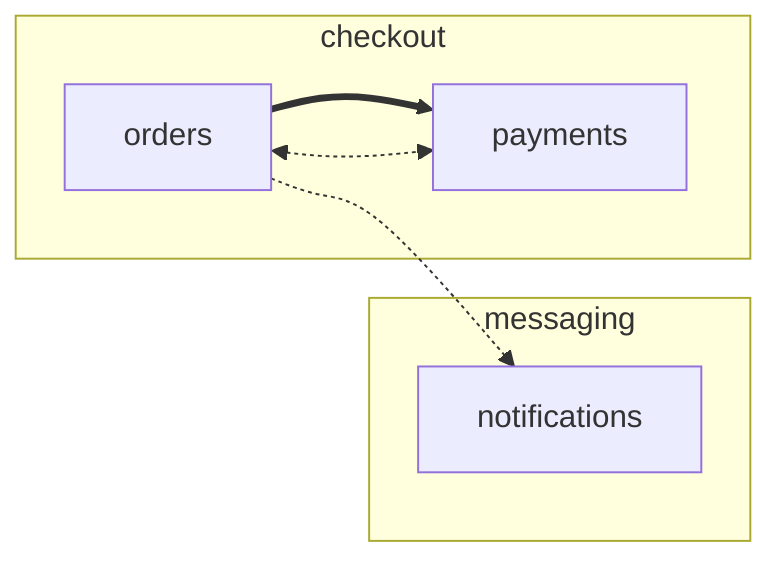

# multi-repo — Spec Kit workspace orchestration

Orchestrate spec-driven development across a **multi-repo workspace**: one
**central specs repository** owns the feature specs, and implementation is
dispatched headlessly to each **member repository** (Lambda, Glue, SQS, Step
Functions, …) in dependency order.

This is a Spec Kit extension package (Route B): it uses only stable extension
surfaces — an extension (agent commands + hooks), a custom workflow step, and
a workflow definition — without modifying the Spec Kit core.

> 📖 **New here?** Follow the [tutorial](docs/tutorial.md) — it builds a
> three-repository workspace from scratch and takes a feature through
> split, dispatch, failure, and resume.

## How it works

```
central specs repo                    member repos
┌───────────────────────────┐        ┌──────────────────┐
│ specs/001-feature/        │        │ repo-s3          │
│   spec.md  plan.md        │  wave  │  .specify/       │
│   tasks.md (orchestration)│ ─────► │  agent runs the  │
│   tasks/s3.md             │        │  implement slice │
│   tasks/lambda.md         │        ├──────────────────┤
│ .specify/workspace.yml    │  wave  │ repo-lambda      │
│   members + depends_on    │ ─────► │  (depends on s3) │
└───────────────────────────┘        └──────────────────┘
```

1. Spec, plan, and tasks are produced in the central repo with the standard
   Spec Kit commands.
2. `/speckit.multi-repo.tasks` splits `tasks.md` into `tasks/<member>.md`
   files and rewrites the root `tasks.md` as an orchestration page.
3. `specify workflow run multi-repo` dispatches `speckit.multi-repo.implement`
   to each member with a participating task file, in topological waves
   computed from `workspace.yml`. Each member's agent runs with its own repo
   as the working directory and the central feature directory exported via
   `SPECIFY_FEATURE_DIRECTORY`.
4. After each member's agent finishes, the step runs the `## Verification`
   commands of its task file in the member repo: the member is done only if
   every exit code matches (optionally re-dispatching the agent with the
   failure log, `verify_retries`). Contract-check members verify cross-repo
   contracts after their producers. The orchestration page's Status column
   follows along (`dispatched → verified | failed`).
5. The workflow's gates keep a human in the loop (the review gate shows the
   verification report); `workflow resume` picks up after a member failure,
   skipping members whose task files are fully checked off and whose checks
   pass.

## Install

Requirements: **Spec Kit ≥ 1.1.0** (`specify --version` to check), member
repos initialized with `specify init --integration <agent>`.

1.1.0 is required because installing the custom workflow step needs
`specify workflow step add --dev/--from` (introduced in Spec Kit 1.1.0).
Upgrade with `specify self upgrade` (uv-tool and pipx installs are upgraded
automatically; `--dry-run` previews first). On Spec Kit 1.0.x, the
extension and workflows still install, but the step has to be copied by
hand: `cp -R step/multi-repo-implement <central>/.specify/workflows/steps/`.

### From a GitHub release (no clone needed)

In each **member repository**:

```sh
specify extension add multi-repo --from \
  https://github.com/joaopaschuino/speckit-multirepo/archive/refs/tags/v0.7.1.zip
```

In the **central specs repository**, the two commands above plus:

```sh
specify workflow step add multi-repo-implement --from \
  https://github.com/joaopaschuino/speckit-multirepo/releases/download/v0.7.1/step-multi-repo-implement-v0.7.1.zip
specify workflow add multi-repo --from \
  https://raw.githubusercontent.com/joaopaschuino/speckit-multirepo/v0.7.1/workflow/multi-repo/workflow.yml
specify workflow add multi-repo-check --from \
  https://raw.githubusercontent.com/joaopaschuino/speckit-multirepo/v0.7.1/workflow/multi-repo-check/workflow.yml
```

(The step install asks an interactive trust confirmation before downloading —
default-deny; answer `yes`.)

### From a clone

```sh
./install.sh central /path/to/central-repo                # local (--dev) mode
./install.sh member  /path/to/member-repo --release v0.7.1 # release mode
```

`install.sh` runs, respectively:

```sh
specify extension add <clone-dir> --dev
specify workflow step add multi-repo-implement --dev <clone-dir>/step/multi-repo-implement
specify workflow add <clone-dir>/workflow/multi-repo --dev
```

### Upgrading an existing workspace

Re-run the same `install.sh` command you used originally — that is the
supported upgrade path. Existing components are replaced in place (the
extension and the custom step with `--force`; workflows overwrite by
default) and the member's `AGENTS.md` governance section is refreshed
idempotently. Nothing else in your repositories is touched; governance
bundles are regenerated per dispatch, so there is nothing to migrate.

```sh
./install.sh central /path/to/central-repo --release v0.7.1   # or --dev <clone-dir>
./install.sh member  /path/to/member-a --release v0.7.1
./install.sh member  /path/to/member-b --release v0.7.1

specify workflow run multi-repo-check   # verify: every member should report ready
```

Read the `Upgrade` section of the target version in the
[CHANGELOG](CHANGELOG.md) first — some releases carry extra steps (for
example manifest format changes).

If your `PATH` carries a `specify` older than 1.1.0, point the script at the
right binary: `SPECIFY_BIN=/path/to/specify ./install.sh …`.

The manual equivalent, without `install.sh` (note the `--force` flags — a
plain re-add fails on an existing installation):

```sh
# central
specify extension add multi-repo --from <ext-zip-url> --force
specify workflow step add multi-repo-implement --from <step-zip-url> --force
specify workflow add multi-repo --from <workflow-url>
specify workflow add multi-repo-check --from <check-workflow-url>
# each member (plus the AGENTS.md governance section, via install.sh member)
specify extension add multi-repo --from <ext-zip-url> --force
```

### Repository topologies

`workspace.yml` member `path`s are relative to the central root, so these
layouts work:

- **Sibling checkouts**: `path: ../repo-lambda` (simplest; what the tests use)
- **Git submodule of the specs repo inside each member**: point the member
  entry at the member checkout location relative to the central repo
- **Mono-repo**: the repository root is the central project and each stack
  is a member subdirectory (`path: apps/web`, `path: services/api`)

#### Mono-repo

Run `specify init` at the repository root (central: `specs/`,
`.specify/workspace.yml`) and again inside each member subdirectory
(`specify init --here --integration <agent>` in `apps/web`, …). Spec Kit
resolves the nearest `.specify/` upwards, so each member's agent runs as its
own project, with its subdirectory as the working directory:

```yaml
members:
  - id: api
    path: services/api      # Go
  - id: worker
    path: services/worker   # Python
    depends_on: [api]
  - id: web
    path: apps/web          # Next.js
    depends_on: [api]
```

What differs from separate repositories:

- **One working tree**: the feature branch created at the root covers every
  member, so the feature lands as one PR. Keep `max_concurrency: 1` —
  parallel agents share the same `.git` and would race on commits.
- **No repository boundary**: a member's agent can edit other members'
  directories. Its task slice and governance bundle scope it; review the
  feature PR per directory.
- **Root context files are inherited**: agents read `CLAUDE.md` /
  `AGENTS.md` from parent directories, so the root one reaches every
  member. Keep it stack-neutral; put stack rules in each member's
  `.specify/memory/constitution.md` or a type `constitution`.

## Workspace manifest — `.specify/workspace.yml`

```yaml
schema_version: "1.0"
workspace:
  id: my-platform
  name: "My Platform"
members:
  - id: lambda
    path: ../repo-lambda
    constitution: constitutions/lambda.md  # shared by every lambda member
    integration: claude        # optional; default: member's integration.json
    tasks_file: tasks/lambda.md  # optional; default: tasks/<id>.md
    depends_on: []               # members that must complete first
    domain: ingestion            # optional; business domain of the member
    communicates_with: [s3]      # optional; members it talks to at runtime
  - id: s3
    path: ../repo-s3
    domain: ingestion
    communicates_with: [lambda]  # bidirectional: lambda <-> s3 is allowed
```

Validation: unique slug ids, `path` must be a Spec Kit project at dispatch
time, `depends_on` must reference known members, the graph must be acyclic,
`communicates_with` must reference known members other than the member
itself, and a member's `constitution` file must exist in the central repository
(fail-fast before any dispatch). Waves are computed per feature over the
participating subset only — a member not in the feature never blocks its
dependents.

**Execution order vs. domain topology.** The manifest carries two graphs
with different meanings:

| Field | Meaning | Cycles | Affects dispatch |
|-------|---------|--------|------------------|
| `depends_on` | **Execution order** — who must finish before this member is dispatched | rejected | yes — the only input to waves and `ready: false` holds |
| `communicates_with` | **Communication topology** of the domain — which members talk to each other at runtime (API calls, events, queues) | allowed (communication is often bidirectional) | no — documentation for humans and agents |

`domain` (optional, free-form string) groups members by business domain.
For example, an order service and a payment service that call each other
are a communication cycle, while only the producer of the shared contract
has to be implemented first:

```yaml
members:
  - id: orders
    path: ../repo-orders
    domain: checkout
    communicates_with: [payments, notifications]
  - id: payments
    path: ../repo-payments
    domain: checkout
    depends_on: [orders]               # orders publishes the contract first
    communicates_with: [orders]        # payments calls back into orders
  - id: notifications
    path: ../repo-notifications
    domain: messaging                  # consumes events; never calls back
```

`specify workflow run multi-repo-check` reports each member's `domain` and
`communicates_with`, plus a `topology` Mermaid diagram — one subgraph per
domain, thick arrows for `depends_on` (dependency → dependent, in dispatch
order), dotted arrows for communication (`<-.->` when both sides list each
other):

Members used by several domains (a shared bucket, an event bus, a central
auth service) get `domain: platform` (or `shared-*`): they keep their own
subgraph, and every consumer shows up as a cross-domain edge — the diagram
makes inter-domain coupling explicit.



> **Naming tip**: member ids may be full repository names (e.g.
> `itau-nm8-lambda-integracao`) — the task file then defaults to
> `tasks/itau-nm8-lambda-integracao.md`, keeping every artifact
> self-describing. With several repos of the same type, repo-named ids beat
> generic ones (`lambda`, `lambda-2`).

## The workflow step — `multi-repo-implement`

```yaml
- id: implement
  type: multi-repo-implement
  feature: "specs/001-my-feature"   # default: active feature
  repos: [s3, lambda]               # default: members with a tasks file
  command: speckit.multi-repo.implement
  max_concurrency: 1                # per-wave parallelism (captured output)
  dispatch_timeout: 3600            # seconds, every dispatch (sequential and parallel) and every check
  verify_retries: 0                 # re-dispatches after a failed verification, with the failure log
  skip_completed: true              # skip members whose tasks are all [x] (and whose checks pass)
  persist_feature: false            # keep feature.json in members
  stop_on_failure: true             # halt before the next wave on failure
  dry_run: false                    # report readiness and waves, dispatch nothing
  missing: error                    # error | skip for locally-absent members
```

Output (usable in later steps / gates via `{{ steps.implement.output.* }}`):
`feature`, `waves` (list of member-id lists), `results` (per-member
`repo`, `wave`, `status` completed|failed|skipped|missing|not-ready,
`exit_code`, `tasks_file`, `attempts`, `timed_out`, and `verification` —
`status` verified|failed|skipped plus each command's `exit_code`,
`expected_exit`, `status`, and log tail), `failed`, `missing`, `not_ready`,
`verification` (member id → verified|failed|skipped),
`verification_summary` (one line), `verification_report` (path of the
Markdown report the review gate shows), and `members` (the readiness
report; every declared member on dry runs, with `status`, `reason`,
`integration`, `constitution`, `domain`, `communicates_with`, `participant`,
and `verify_only`). Dry runs also return `topology`, a Mermaid flowchart of
the workspace's domains, dependency edges, and communication edges.

Dispatch details: each member's agent CLI runs headless (`claude -p …`,
`copilot -p … --yolo`, …) with `cwd` = the member repo. Environment for every
dispatch: `SPECIFY_FEATURE_DIRECTORY=<central feature dir>` and
`SPECIFY_FEATURE_NO_PERSIST=1` (unless `persist_feature: true`). The member's
tasks file is passed as the command argument, not as an environment variable,
so concurrent waves cannot race on it — followed by the member's governance
bundle (all constitution layers assembled into one file), also as an argument.
`dispatch_timeout` bounds every dispatch: parallel (captured) dispatches
natively, sequential (streamed) ones through a watchdog that kills the agent
process once the timeout elapses — the member is then `failed` with
`timed_out: true`, so an unattended run never hangs on one agent.

### Dispatch and objective verification (router / worker)

The central repository is the router and each member's agent a worker; the
router decides whether a worker is done from **exit codes, not from the
agent's report**. Every member task file ends with a `## Verification`
section (generated by `/speckit.multi-repo.tasks`, preserved on re-runs):

```markdown
## Verification

- lint: `npm run lint` → exit 0
- type-check: `npx tsc --noEmit` → exit 0
- test: `npm test` → exit 0
- e2e: `npm run test:e2e` → exit 0
```

For each member, in dependency-wave order, the step:

1. sets the member's row in the orchestration page (`<feature>/tasks.md`)
   to `dispatched` and dispatches its agent (task file, governance bundle);
2. parses `## Verification` from the task file and runs every command with
   POSIX `sh`, `cwd` = the member repository, and
   `SPECIFY_FEATURE_DIRECTORY` exported — every command runs even after a
   failure, each bounded by `dispatch_timeout`, output appended to
   `<feature>/verification/<member>.log`;
3. records `verification: verified` (all exit codes as expected), `failed`,
   or `skipped` (no section / no commands, or the dispatch itself failed),
   and sets the row's Status to `verified`, `failed`, or `completed`
   (dispatched fine, nothing to verify);
4. on a failed verification with `verify_retries: N`, writes
   `<feature>/verification/<member>.feedback.md` (each failing command, its
   exit code, and output tail) and re-dispatches the agent with that file as
   a third argument — up to N more times. Default 0: fail immediately.

A member that fails verification is `failed` like a failed dispatch:
`stop_on_failure` halts before the next wave and `workflow resume` retries
it. With `skip_completed`, a fully checked-off task file is no longer taken
at its word: its checks run first, and the agent is re-dispatched (with
feedback) if they fail. The run's summary lands in
`<feature>/verification/report.md`, which the `multi-repo` workflow's
review gate displays.

**Dispatching subsets — `ready: false`.** A task file starting with YAML
front matter

```markdown
---
ready: false
---
```

is held back (`status: not-ready`, listed in `not_ready`), and so is every
participant that depends on it; the rest of the feature dispatches. Remove
the flag and re-run to dispatch the remainder.

### Cross-repo contract checks — verification-only members

Contracts between members are verified by an ordinary workspace member
whose task file has a `## Verification` section **and no task checkboxes**.
Such a member is *verification-only*: no agent is dispatched, its commands
run in its repository once the producers' wave has finished, and it only
needs its `path` to exist (a plain contracts repo works — no Spec Kit
scaffolding required). Point it at the consumer repository or at a
dedicated contracts repository and list every producer in `depends_on`:

```yaml
members:
  - id: api                         # producer
    path: ../repo-api
  - id: web                         # consumer
    path: ../repo-web
    depends_on: [api]
  - id: contract-check              # verification-only member
    path: ../repo-web               # consumer repo (or ../repo-contracts)
    tasks_file: tasks/contract-check.md
    depends_on: [api]               # every producer of the contract
```

`specs/<feature>/tasks/contract-check.md` (generated by
`/speckit.multi-repo.tasks` when the feature has contracts between members):

```markdown
# Contract check — 001-orders

Producers: api · Consumer: web · Contracts: `contracts/` (feature directory)

## Verification

- schema-diff: `npx @openapitools/openapi-diff "$SPECIFY_FEATURE_DIRECTORY/contracts/openapi.yaml" ../repo-api/openapi.yaml` → exit 0
- consumer-contract: `npm run test:pact -- --pact-dir "$SPECIFY_FEATURE_DIRECTORY/contracts/pacts"` → exit 0
```

Waves: `[api]`, then `[web, contract-check]` — the contract is checked
against what the producer actually built, and a break fails the run like
any other member (resume after fixing the producer).

## Constitutions

Governance lives in the central repository and is consumed live at dispatch
time — one source of truth, no copies to synchronize. The orchestrator reads
every layer that exists, assembles it into a **governance bundle**, and hands
the bundle to the member's agent; when layers conflict, **the most
restrictive rule wins** (each layer narrows the one above, never loosens it):

1. **Workspace** — `central/.specify/memory/constitution.md`: rules true for
   the whole platform (edited with `/speckit.constitution` in the central
   repo, as in any Spec Kit project)
2. **Member/type** — a shared file declared per member in `workspace.yml`
   (`constitution: constitutions/lambda.md`). Keep it next to the manifest —
   for example `central/constitutions/{lambda,glue,sqs,step-functions}.md` —
   and put in it only rules true for the whole type (runtime, naming,
   mandatory checks). Several members of the same type point at the same
   file, so ten Lambda repos read one Lambda constitution
3. **Local** — `member/.specify/memory/constitution.md`: repo-specific
   exceptions only

At dispatch time the orchestrator validates every configured constitution
file (a missing or unreadable file fails the run, with the path in the
error), embeds all three layers in `<feature>/governance/<member>.md`, and
passes that bundle's absolute path to the member's command — so the agent
reads one authoritative file instead of resolving layer paths itself, and
the bundle doubles as an audit record of exactly which rules each member
received. A layer that is still the unmodified `specify init` template is
reported as absent, so placeholder text never reaches a dispatched agent as
if it were governance. Later steps of the member's completion report name
which layers applied and any rule that overrode a task.

Members also carry a persistent pointer in their `AGENTS.md` (written by
`install.sh member`, idempotent) naming the three layers and the
most-restrictive-wins rule — the channel that keeps free-form edits, which
bypass the implement command entirely, subject to governance.

Resume semantics: the engine re-executes the step from the top on
`workflow resume`. That is safe because re-dispatching a member whose tasks
are complete is a no-op for the agent, and `skip_completed` avoids even that
dispatch. Bundles are regenerated on every dispatch, so a resumed member
always receives the current rules.

## Usage walkthrough

```sh
# central repo — usual SDD cycle for the feature
/speckit.specify <description>     # gate: approve
/speckit.plan <description>        # gate: approve
/speckit.tasks <description>

# split tasks across members (also offered automatically by the after_tasks hook)
/speckit.multi-repo.tasks

# dispatch implementation (interactive gates)
specify workflow run multi-repo -i feature=specs/001-my-feature

# or fully non-interactive (CI): pre-approve the gates via inputs
specify workflow run multi-repo \
  -i feature=specs/001-my-feature -i confirm=approve -i review=approve --json

# a member failed? fix it, then:
specify workflow resume <run-id>
```

Inside a member repo, `/speckit.multi-repo.implement` also works standalone
(interactively) — it resolves the feature via `SPECIFY_FEATURE_DIRECTORY` or
the member's persisted `feature.json`, and the member's task file via
argument, `SPECKIT_MULTI_REPO_TASKS_FILE`, or the extension config.

## Help

`/speckit.multi-repo.help` — installed with the extension in the central and
every member repository — answers orientation questions in the agent chat,
in your language: where to start with an idea, which command runs next for
the current repository and feature state, how waves, resume, and governance
work. It detects the repository's role before answering, and it is
read-only: it explains and recommends, never dispatches or edits.

## Workspace check & scaffolding

Two tools keep the workspace healthy as the team grows:

**`specify workflow run multi-repo-check`** — a read-only doctor for the
workspace. It runs the orchestrator step in `dry_run` mode: every declared
member is classified (`ready` / `not-cloned` / `not-initialized` /
`no-integration` / `unknown-integration` / `no-dispatch` /
`constitution-missing`), participation is computed against the active
feature (or the whole workspace when no feature is given), and dispatch
waves are listed — nothing is dispatched. Use `--json` for a
machine-readable report:

```sh
specify workflow run multi-repo-check --json \
  | jq '.step_results.check.output.members'
specify workflow run multi-repo-check --json \
  | jq -r '.step_results.check.output.topology'   # Mermaid diagram
```

**`missing: skip`** — for teams where each person has cloned only part of
the workspace. By default (`missing: error`) a participant that is not
cloned locally aborts the run before any dispatch. With `skip`, absent
participants are recorded as `status: missing` (with the reason) and the
ready members are dispatched:

```sh
specify workflow run multi-repo -i missing=skip
```

Configuration mistakes (no integration, unknown integration, missing
constitution file) still abort in both modes — `skip` covers local absence,
not manifest errors.

**`/speckit.multi-repo.workspace`** — agent command for the central repo,
with two modes:

- *Scaffold* (no manifest yet): scans sibling directories and
  subdirectories of the repo root (two levels deep, for mono-repos) for Spec
  Kit projects and proposes a `.specify/workspace.yml` (ids from directory
  names — derived from the relative path when names collide, e.g.
  `apps-web` / `services-web` — and relative paths). It never invents `depends_on` — the dependency
  graph is human knowledge; interactively it asks, headlessly it writes the
  graph empty with a warning
- *Audit* (manifest exists): per-member readiness table, drift detection
  (undeclared Spec Kit projects), and confirmed additions only — existing
  entries and their dependencies are never modified

**`/speckit.multi-repo.domain`** — agent command for the central repo that
fills the manifest's domain view (`domain`, `communicates_with`) from
evidence instead of memory. It scans member repositories for the signals of
communication — IaC and deployment descriptors, OpenAPI/AsyncAPI/proto
specs, `.env` and config, HTTP clients, queue/topic/bucket/state-machine
names, the feature `contracts/` — and turns matching resource names into
edges with a channel, a direction, a confidence level, and `file:line`
evidence. Two modes:

- `auto` — sweep every cloned member, present the whole proposal (tables
  plus the Mermaid topology), confirm, write
- `guided [<member>]` — start from the piece you know best and walk the
  flow outward: the agent scans one member, shows what it talks to, you
  correct it and add the business context the code cannot show (what the
  edge carries, who owns it), and the confirmed neighbours become the next
  stops. Stop whenever you want; the rest stays *not mapped*

In both modes the manifest changes only after confirmation (headless runs
write the proposal and touch nothing), only `domain` and
`communicates_with` are written — never `depends_on` — and the result
lands in `.specify/memory/domain.md`: the topology diagram, a
communication table (from, to, channel, direction, confidence, evidence),
external systems, and the team's notes per domain. `/speckit.multi-repo.tasks`
reads that map when assigning integration tasks to members.

## What lands in each repository

The design principle: **all feature state lives in the central repository;
member repositories are only destinations for implementation**.

**In members — install time (once, committed):**

- The standard `.specify/` from `specify init` (templates, scripts, local
  `memory/constitution.md`, `integration.json`)
- The extension: `.specify/extensions/multi-repo/` + the hook registry in
  `.specify/extensions.yml`
- The agent commands (for example `.claude/skills/speckit-multi-repo-implement`)
- A "Multi-repo workspace governance" section in `AGENTS.md` (idempotent,
  marker-delimited; written by `install.sh member`)

**In members — during a feature (runtime):**

- The implemented code and tests — the only new content, so a member's PR is
  a pure implementation diff, with no spec or metadata mixed in

Nothing else, by default:

| Artifact | Lives in | Why |
|---|---|---|
| `spec.md`, `plan.md`, `tasks.md`, per-member task files | Central | Single source of truth |
| Task checkboxes `[x]` | Central (the agent edits the task file through `FEATURE_DIR`) | Progress is feature state, not member state |
| Member's `.specify/feature.json` | Not written | The step runs with `persist_feature: false`, which sets `SPECIFY_FEATURE_NO_PERSIST=1` |
| Workflow runs (`.specify/workflows/runs/`) | Central only | The orchestrator is the single status writer |
| Spec/contract copies | None | The agent reads them live from the central repository |
| Verification logs, retry feedback, report (`verification/`) | Central | Written by the orchestrator under the feature directory |

**The one exception, opt-in:** `persist_feature: true` makes the member
record the central feature directory in its `.specify/feature.json` — useful
to keep working on that feature interactively inside the member afterwards.
It is off by default to keep members clean and allow concurrent dispatches
without state races.

**In the central repository:** the feature (`spec.md`, `plan.md`,
orchestration `tasks.md`, per-member task files, `contracts/`, and the
derived `governance/` bundles and `verification/` logs), the workspace manifest, shared
constitutions, and the workflow run history.

## Design notes — the path to a native feature (Route C)

The manifest is deliberately shaped as a candidate native contract:

- `workspace.yml` members (`path`, `integration`, `tasks_file`,
  `depends_on`) map one-to-one onto a hypothetical core step field
  (`project:`/`depends_on`) and workspace resolution in the engine
- The step implements "dumb executor, graph in data": participation comes
  from the feature's `tasks/` directory, order from the manifest — nothing is
  hardcoded in scripts
- If accepted upstream, the extension step becomes a built-in step type and
  the extension commands can merge into the core templates without a format
  break for existing workspaces

Until then, this package is the reference implementation to collect usage
evidence (integration rework, spec→PR lead time, breaking-change rate) for
an upstream RFC.

## Limitations (v1)

- Constitution enforcement still happens through the implementing agent:
  the orchestrator now delivers the rules mechanically (bundles assembled
  at dispatch, persistent `AGENTS.md` pointer in members) instead of trusting
  the agent to resolve layer paths. Objective checks (`## Verification`,
  contract-check members) are validated mechanically by exit code, but a
  constitution rule with no corresponding command is still applied by the
  agent alone — encode the mandatory ones as Verification commands;
  member-local constitutions live in the
  member repo by design (their content is embedded in the dispatch-time
  bundle; only workspace and type layers are centralized sources of truth)
- Verification is only as strong as the commands in the task file: the
  orchestrator checks exit codes and cannot tell a meaningful suite from a
  trivial one, so review the generated `## Verification` sections. Commands
  run in the member repository with the orchestrator's privileges — treat
  task files like any other code you execute
- The sequential-mode watchdog relies on the integration launching its agent
  through `subprocess.run` (true for the Spec Kit base integration); a
  custom integration that spawns processes differently is bounded only in
  parallel mode. The agent stays in the orchestrator's process group, so
  the terminal, Ctrl+C, Ctrl+Z and hang-ups behave as without the watchdog.
  On timeout the agent is frozen and its process tree is killed —
  descendants first (found through parent/child links, so also those that
  moved to another process group or session), then the agent. Descendants
  already re-parented to init (double-forked daemons, background services
  detached with `&` from a shell that has since exited) are out of reach
  and can survive the timeout. Parallel (captured) dispatches are bounded by
  the core, which kills only the agent process
- No automatic cross-repo contract synchronization (contract-check members
  verify, they do not sync): follow the
  [contract-driven development guide](https://github.com/github/spec-kit/blob/main/docs/guides/contract-driven-development.md)
  and keep contracts under the feature's `contracts/` directory
- No bundle/catalog packaging yet: install via `install.sh` (local paths) or
  adapt the three `--dev` commands to URLs
- Parallel waves capture agent output instead of streaming it (interleaved
  live streams would be unreadable); sequential waves stream live

## Development

The test suite needs the `specify_cli` package importable — run it from a
[Spec Kit checkout](https://github.com/github/spec-kit) with this repository
cloned inside it, or from any virtualenv that has `specify-cli` installed:

```sh
# from a spec-kit checkout with this repo at ./multi-repo (or adjust the path)
uv sync --extra test
.venv/bin/pytest multi-repo/tests

# from this repository, using that venv
/path/to/spec-kit/.venv/bin/pytest tests
```

`tests/test_workspace.py` covers the manifest parser/validator and wave
computation; `tests/test_step.py` covers step execution with a stubbed
integration; `tests/test_e2e_workflow.py` installs the components through the
real CLI and runs/resumes a workflow against a fake agent executable
(`SPECKIT_INTEGRATION_CLAUDE_EXECUTABLE`).

## Releasing

```sh
./make-release.sh            # builds dist/step-multi-repo-implement-vX.Y.Z.zip
git tag vX.Y.Z && git push origin vX.Y.Z
gh release create vX.Y.Z dist/step-multi-repo-implement-vX.Y.Z.zip --title vX.Y.Z
```

The extension installs straight from the tag archive; the custom step ships
as a dedicated release asset because `specify workflow step add --from`
expects `step.yml` at the archive root. Update `extension.yml` version,
`CHANGELOG.md`, and the README install URLs together (semver). Before
tagging, smoke-test both install paths on a scratch workspace: a fresh
`install.sh` run and a re-run over an existing install (the upgrade path).

