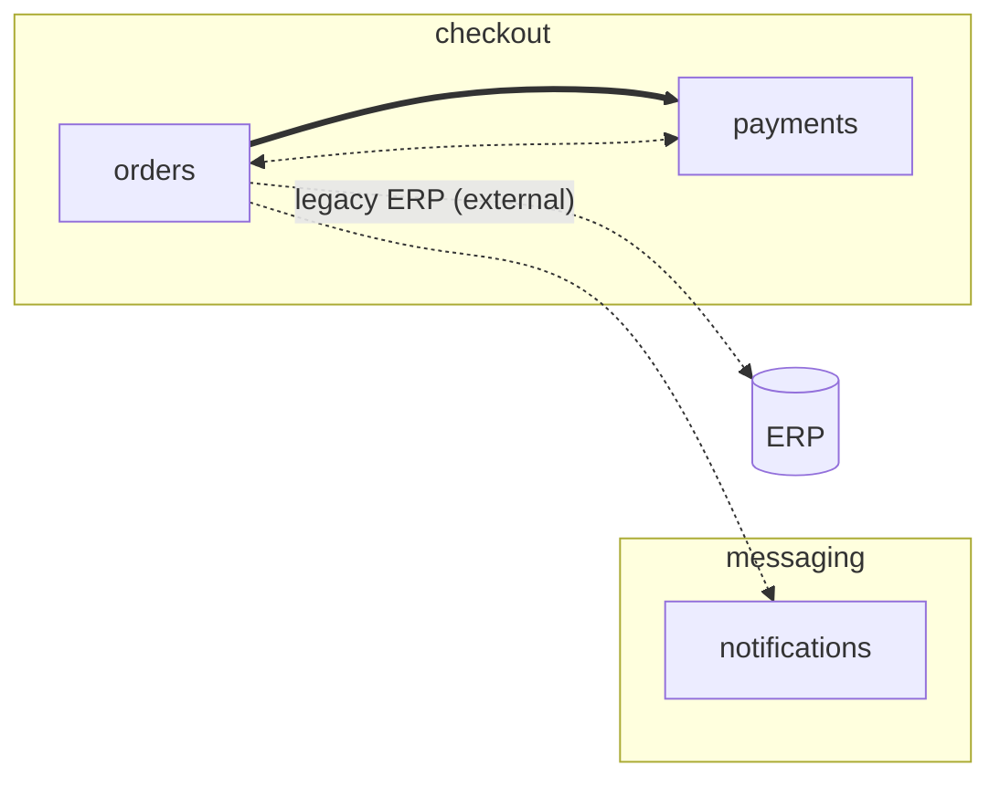

## User Input

```text
$ARGUMENTS
```

Accepted forms:

- `auto` — scan every declared member, propose the whole topology at once, confirm, write.
- `guided [<member-id>]` — start from one member (the "initial piece") and walk the topology edge by edge in a conversation; the user supplies the domain context the code cannot show.
- empty — ask the user which mode to use (headless: behave as `auto`).

## Purpose

This repository is the **central specs repository** of a multi-repo workspace. `.specify/workspace.yml` already declares the members and the execution order (`depends_on`). This command fills in the **domain view** of the same manifest — the optional member fields `domain` and `communicates_with` — and writes a human-readable domain map at `.specify/memory/domain.md` (diagram, communication table with channel and direction, and the context the user gave).

Two graphs, two meanings — keep them apart at all times:

| Field | Meaning | Cycles | This command |
|-------|---------|--------|--------------|
| `depends_on` | execution order of dispatch | rejected | **never reads it as evidence, never writes it** |
| `communicates_with` | runtime communication (calls, events, queues, shared storage) | allowed | proposes it from evidence, writes it after confirmation |

Rules that apply in every mode:

- **Evidence or nothing.** Every proposed edge cites at least one file and line in a member repository (or in this repository's feature `contracts/`). An edge the user asserts without evidence is recorded with `evidence: user` — never silently invented.
- **Confirmation before writing.** The manifest is modified only after the user confirmed the proposal (interactive) — headless runs write the proposal to the domain map marked *unconfirmed* and leave the manifest untouched.
- **Only `domain` and `communicates_with` change.** Never add, remove, or reorder members; never touch `depends_on`, `path`, `tasks_file`, `integration`, or `constitution`. Preserve existing comments and key order as far as the YAML tooling allows; when a member already has `domain`/`communicates_with`, show the diff and ask before replacing.
- **Validity.** `communicates_with` entries must be known member ids, never the member itself, deduplicated. Cycles are fine.

## Step 1 — Load the manifest

Read `.specify/workspace.yml` from the repo root. If it is missing or invalid, **STOP** with: `No valid workspace manifest at .specify/workspace.yml. Run /speckit.multi-repo.workspace first (central specs repository).`

For each member note `id`, `path` (relative to this repo root), any existing `domain` and `communicates_with`. Check which member paths exist on disk; members that are not cloned cannot be scanned — list them as *unscanned* in the report and never propose edges *from* them (edges *to* them may still appear from other members' code).

Also note `specs/*/contracts/` in this repository: contract files between members are first-class evidence of communication.

## Step 2 — Scan a member (shared by both modes)

For member `M` at `path`, look for signals that it talks to another member. Read, in this order of value: IaC and deployment descriptors, interface specs, configuration, then source. Record every hit as `(from, to, channel, direction, file:line, snippet)`.

**Where to look**

- IaC: `*.tf`, `template.y*ml` / `samconfig.toml` (SAM/CloudFormation), `serverless.y*ml`, `cdk*/`, `Pulumi.*`, `k8s/`, `helm/`, `docker-compose*.y*ml`
- Interface specs: `openapi.*`, `swagger.*`, `asyncapi.*`, `*.proto`, `*.graphql`, `pacts/`, the central feature `contracts/`
- Configuration: `.env*`, `config/`, `appsettings*.json`, `application*.y*ml`, `settings.py`, CI workflows
- Source: HTTP clients (`fetch`, `axios`, `requests`, `httpx`, `HttpClient`, `RestTemplate`, `WebClient`), messaging SDKs (SQS/SNS/EventBridge/Kinesis, Kafka producers/consumers, RabbitMQ, Pub/Sub), storage clients (S3 buckets, shared tables), orchestration (Step Functions ASL, Lambda `invoke`), service discovery names, gRPC stubs
- Docs: `README*`, `docs/`, ADRs — only as corroboration, never as sole evidence of an edge

**How a hit becomes an edge to another member `N`**

1. The hit names `N`'s id, repository/directory name, service name, or a host/URL/ARN that clearly belongs to `N` (check `N`'s own IaC or README for the resource it owns), or
2. The hit names a shared resource (queue, topic, bucket, table, event bus + detail-type, state machine) and the **same resource name** appears in `N` with the complementary role (one side sends/writes/publishes, the other receives/reads/subscribes), or
3. A central `contracts/` file names both `M` and `N` (producer/consumer).

Then classify:

- `channel`: `http` | `grpc` | `graphql` | `queue` | `topic` | `event-bus` | `stream` | `storage` | `state-machine` | `invoke` | `db` | `other` (name the resource, e.g. `queue:orders-created`)
- `direction`: `calls` (M sends requests to N, sync), `produces` (M emits messages/data N consumes), `consumes` (M reads what N emits) — `consumes` is just the reverse view of `produces` on the other member; keep one row per *logical* edge and merge duplicates found from both sides
- `confidence`: `high` (both sides reference the same resource, or a contract names both), `medium` (one side names the other explicitly), `low` (name similarity only — e.g. a host that *probably* belongs to N). Report low-confidence edges as **questions**, never as proposals.

**Manifest form.** The manifest stores only member ids. `M.communicates_with` gets `N` whenever `M` *initiates* toward `N` — `calls` or `produces`. A `consumes` hit found in `M` becomes `N.communicates_with: [M]` (N produces to M). Two members that call each other list each other; the diagram shows this as a bidirectional edge.

**Domain hint.** From the member's README, service name, IaC tags (`Domain`, `Team`, `BoundedContext`), module/package names, and existing `constitution` type, propose a short lowercase `domain` label (e.g. `checkout`, `ingestion`, `identity`). Mark it *proposed* — the domain name is business vocabulary, and the user has the final say.

Keep scans bounded: skip `node_modules/`, `.git/`, `vendor/`, `dist/`, `build/`, `target/`, `.venv/`, and binaries; prefer `rg`/`grep -rn` with the patterns above over reading files whole.

## Mode A — `auto`

1. Scan every cloned member (Step 2). Merge edges found from both sides; collapse duplicates by `(from, to, channel)`.
2. Present the **proposal** — one table per member:

   ```markdown
   ### orders  (domain: checkout — proposed)

   | Talks to | Channel | Direction | Confidence | Evidence |
   |----------|---------|-----------|------------|----------|
   | payments | http:/v1/charges | calls | high | src/clients/payments.ts:14 · ../repo-payments/openapi.yaml:3 |
   | notifications | topic:order-events | produces | high | infra/sns.tf:8 · ../repo-notifications/handler.py:22 |

   Open questions
   - orders → inventory? `INVENTORY_URL` in .env.example:7 has no matching resource in inventory (low confidence)
   ```

   followed by the Mermaid topology (format in Step 4) and the list of unscanned members.
3. **Interactive**: ask the user to confirm, correct domain names, accept or reject each open question, and add anything the scan missed (recorded as `evidence: user`). Then go to Step 4.
   **Headless** (no user to answer): go to Step 4 in *unconfirmed* mode — write the domain map only, print where it is, and print the exact YAML the user would apply to the manifest.

## Mode B — `guided`

A conversation that grows the map from one member outward. Use it when the team knows the business domain but not every integration in the code — or the reverse.

1. **Initial piece.** If `<member-id>` was given, start there; otherwise ask: *"Which member is the heart of the flow you want to map?"* Also ask one open question for context: *"In one or two sentences, what does this member do for the business, and which domain would you say it belongs to?"* Record the answer verbatim as the member's domain notes.
2. **Scan the current member** (Step 2) and present only *its* findings: outgoing and incoming edges with evidence, open questions, and the proposed `domain` (reconciled with what the user just said).
3. **Ask, then listen.** For this member only: confirm or correct each edge, answer the open questions, name anything missing (*"Does orders talk to anyone else — a cache, a legacy system, a member not in this workspace?"*), and give the domain context the code cannot show (why the edge exists, which business event it carries, ownership). Record user statements as domain notes; record user-asserted edges with `evidence: user`. Edges to systems that are **not** workspace members are kept in the domain map as *external* (they never enter `communicates_with`).
4. **Advance the frontier.** Every confirmed neighbour not yet visited joins a queue. Show the queue (*"Next: payments, notifications. Continue with payments, pick another, or stop here?"*). Scanning the next member will often confirm the previous one's edges from the other side — say so when it happens, and surface new open questions as they appear.
5. **Stop when the user says so or the queue is empty.** Members never reached are listed as *not mapped* (not as isolated — absence of a visit is not evidence of absence of communication). Summarise what was mapped, then go to Step 4.

The user can switch to a full sweep at any point (*"scan the rest automatically"*): finish with Mode A over the remaining members, keeping everything already confirmed.

## Step 3 — Apply to the manifest (after confirmation only)

For each confirmed member set `domain` (if the user named one) and `communicates_with` (sorted, deduplicated, confirmed targets only — no low-confidence, no external systems). Leave every other key and member untouched. Re-validate the result mentally against the parser's rules (known ids, no self-reference) before writing. Show the resulting YAML fragment to the user.

## Step 4 — Write the domain map

Write `.specify/memory/domain.md` (create `.specify/memory/` if needed; overwrite a previous map, keeping its *Domain notes* section unless the user replaced them):

````markdown
# Domain map — <workspace.name>

<!-- generated by /speckit.multi-repo.domain on <date>; mode: auto|guided; status: confirmed|unconfirmed -->

## Topology



## Communication

| From | To | Channel | Direction | Confidence | Evidence |
|------|----|---------|-----------|------------|----------|
| orders | payments | http:/v1/charges | calls | high | repo-orders/src/clients/payments.ts:14 |
| ... |

## Domains

| Domain | Members | Notes (from the team) |
|--------|---------|-----------------------|
| checkout | orders, payments | "Orders owns the cart→order transition; payments is a thin wrapper over the PSP." |

## Domain notes

### orders
- <user statements, verbatim or lightly edited, dated>

## Not mapped / unscanned

- inventory — not cloned locally
- reporting — not visited (guided run stopped at payments)
````

Diagram conventions match the orchestrator's `topology` output (`specify workflow run multi-repo-check --json | jq -r .step_results.check.output.topology`): one `subgraph` per domain; `a ==> b` for `depends_on` (a before b — copied from the manifest, never inferred); `a -.-> b` for communication, `a <-.-> b` when both list each other; external systems as `x_<name>[("…")]` nodes with a labelled dotted edge.

## Step 5 — Report

- Interactive: what was written (manifest fields changed, domain map path), the open questions left unanswered, and the next step — `specify workflow run multi-repo-check --json` renders the same topology from the manifest; `/speckit.multi-repo.tasks` reads the domain map for context when classifying tasks.
- Headless: the domain map path, the YAML to apply, and a prominent note that **nothing was written to the manifest**.
- Always: remind that `depends_on` was not touched — if the scan revealed a producer/consumer relationship that should also order dispatch, say which one and let the user decide.
